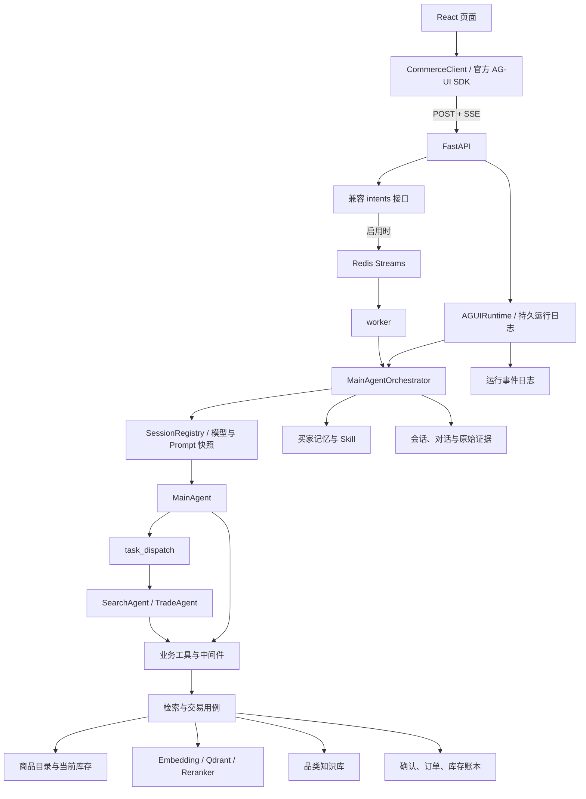
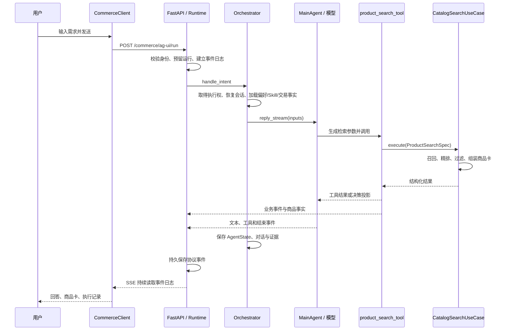
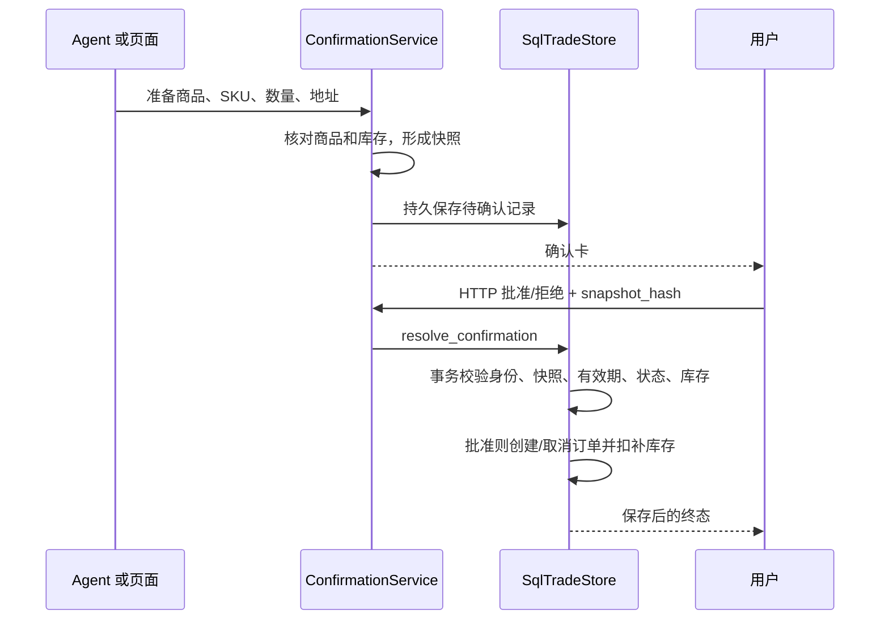

# Globex 项目架构与实现原理教学

核对日期：2026-10-10（Asia/Shanghai）。对象：本工程副本当前源码。

本文以源码的实际装配和执行分支为依据，介绍组件做什么、如何实现、为什么这样设计，以及代价和边界。示例输入均为教学合成内容，不来自真实买家。源码索引见 [组件与源码索引](组件与源码索引.md)，配套练习见第 19 章。

本文不是运行成功报告：本次不调用真实模型、不启动交易、不修改环境配置。工程副本没有 Git 元数据；对应源码指纹与文档校验结果保存在本次改动记录的证据目录。配置表描述源码默认值，运行环境可以覆盖它们。

## 目录

1. [先认识系统解决的问题](#1-先认识系统解决的问题)
2. [整体架构与依赖方向](#2-整体架构与依赖方向)
3. [启动与组件装配](#3-启动与组件装配)
4. [从用户输入走完整条链路](#4-从用户输入走完整条链路)
5. [前端如何管理和展示状态](#5-前端如何管理和展示状态)
6. [接口协议与持久运行日志](#6-接口协议与持久运行日志)
7. [Agent 编排与多 Agent](#7-agent-编排与多-agent)
8. [领域模型与业务用例](#8-领域模型与业务用例)
9. [商品检索和知识 RAG](#9-商品检索和知识-rag)
10. [长期记忆和个人偏好](#10-长期记忆和个人偏好)
11. [Skill、策略和 Prompt 的版本治理](#11-skill策略和-prompt-的版本治理)
12. [上下文治理、压缩与证据回查](#12-上下文治理压缩与证据回查)
13. [模型接入、计数与缓存](#13-模型接入计数与缓存)
14. [交易确认与数据库一致性](#14-交易确认与数据库一致性)
15. [Harness、权限和故障保护](#15-harness权限和故障保护)
16. [队列、worker 与并发恢复](#16-队列worker-与并发恢复)
17. [存储地图与可观测性](#17-存储地图与可观测性)
18. [评测、离线学习和实验边界](#18-评测离线学习和实验边界)
19. [按源码学习和动手验证](#19-按源码学习和动手验证)
20. [设计取舍与常见误解](#20-设计取舍与常见误解)

## 1. 先认识系统解决的问题

Globex 是一个跨境商品选购 Agent。用户说用途、预算、收货地，系统通过模型理解意图，调用商品、知识和交易工具，把回答、商品卡、表单和确认单展示在页面上。

这里有三个不同角色：

- **模型**负责把自然语言转成下一步行动，并组织解释。
- **业务代码**负责检索、校验、价格计算、权限判断和数据库事务。
- **用户**负责补充未知条件，以及批准需要确认的操作。

例如“推荐 300 元以内的轻便背包”：模型选择检索参数；检索用例返回实际目录里的候选；代码过滤超预算和不可配送商品；模型根据候选说明理由。模型不能凭空生成一个商品，然后让页面当成真实商品展示。

当前能力边界：商品是版本化样例目录；订单是持久化的本地购买意向账本；没有真实支付、发货或物流接入。运税是简化规则报价，不能作为现行法规或商家最终报价。ACP 模块是独立沙箱，不意味着主页面已经连接真实商家。

## 2. 整体架构与依赖方向

### 2.1 运行时地图



### 2.2 四层职责

| 层 | 目录 | 核心问题 | 例子 |
| --- | --- | --- | --- |
| 表现层 | `app/presentation/` | 如何接收请求、校验身份、表达错误、传输事件？ | FastAPI、AG-UI 路由、确认接口 |
| 应用层 | `app/application/` | 一项用户需求要调用哪些能力，按什么流程完成？ | Orchestrator、Agent 工厂、工具、用例 |
| 领域层 | `app/domain/` | 什么是有效商品、金额、订单和业务状态？ | Money、Product、Order、各存储端口 |
| 基础设施层 | `app/infrastructure/` | 模型、数据库、缓存、向量库怎样具体工作？ | SQL 存储、模型适配、Qdrant、Redis |

洋葱架构的目标是让业务规则不依赖具体外部服务。领域层定义 `ProductRepository`、`TradeStore` 等端口，基础设施提供实现；应用层通过端口组合工作。`composition.py` 在最外面把实现接到用例上。

需要客观看待：这是采用 DDD 和依赖倒置思路的实战工程，并非严格做到应用层完全不引用基础设施。Agent 工厂、Orchestrator 等存在直接引用。教学时应区分架构意图和当前实现，不能把目录分层等同于全部依赖已经隔离。

**为什么这么设计？** 更换商品源或交易存储时，尽量保留工具合同和用例；业务规则可以不调用模型就测试。代价是文件、接口和装配较多，小功能也要理解跨层协作。

## 3. 启动与组件装配

源码入口：[composition.py](../app/composition.py)、[server.py](../app/presentation/server.py)、[settings.py](../app/infrastructure/settings.py)。

### 3.1 配置集中读取

`load_settings()` 从环境变量和根目录 `.env` 得到 `Settings`。模型、Embedding、Qdrant、Redis、数据目录、上下文和护栏配置在此汇集。密钥字段避免通过普通对象表示打印出来。

这样做能避免不同模块各自读环境导致配置不一致，也让测试可以构造独立 Settings。环境变量优先；不要把文档中的默认值当作正在运行的实际值，也不要为了学习覆盖现有 `.env`。

### 3.2 Composition Root 的接线顺序

`build_container()` 大致完成：

1. 建立 Settings、身份策略、源码指纹和 Prompt 注册表。
2. 建立商品仓储、事件总线、向量索引、Embedding 客户端和知识库。
3. 按配置建立 SQL/文件会话存储、Redis 缓存和队列。
4. 建立交易存储与确认服务。
5. 建立共享限流器、熔断器和 Harness 判定器。
6. 建立检索/订单用例，连接 SearchAgent、TradeAgent 和 MainAgent 工厂。
7. 包装语义记忆存储，建立 SessionRegistry 和 Orchestrator。
8. 建立模型选择、上下文服务和 AG-UI Runtime，返回 Container。

API 与 worker 共用这份接线，降低“网页是一套配置，worker 又是一套配置”的行为漂移。

### 3.3 生命周期不只是 new 对象

FastAPI lifespan 调用 `Container.startup()`：初始化上下文与运行日志、建表、初始化持久库存、绑定库存读取方法、创建队列消费者组、增量建立商品向量和知识索引。

商品索引按批保存，已完成批次可复用；启动建索引失败会记录未完成事实，检索可能降级。交易持久底座不能用内存假装成功，关键初始化失败会阻止启动。代码里的旧注释可能说“所有依赖都可选”，应以具体执行分支为准：可选的是某些能力，可靠保存交易并非可选。

退出时取消/收口运行、关闭模型流、释放向量目录锁、数据库连接和追踪导出器。资源生命周期与业务流程同样重要，否则下一次启动可能被文件锁阻塞。

## 4. 从用户输入走完整条链路

下面以合成需求“预算 300 元，推荐寄到中国的通勤背包”为例，不假设模型必然选择某组参数，也不预先指定推荐商品。



### 4.1 一轮的输入是什么

前端创建 `runId`，保留当前 `threadId`，发送消息列表和买家等元数据。后端 `parse_intent()` 只取最后一条 user 文本；前端传来的旧历史不能覆盖后端 AgentState。也拒绝当前接口不支持的前端自定义工具。

### 4.2 服务端怎样补齐上下文

`handle_intent()` 取得会话锁，`ShoppingContext` 用 ContextVar 携带买家、会话、语言、币种和模型快照。SessionRegistry 恢复状态，绑定当前 Prompt/工具合同和模型版本。随后加载偏好、所选 Skill、当前交易状态和最近候选顺序。

这里不能把“第二个”直接变成某个猜测 ID：最近候选状态只用于解释指代；当前价格、库存和下单条件仍要核验。

### 4.3 一轮与一次模型调用不同z

一次用户请求可以包含多次模型调用、工具调用、子任务和摘要调用。`runId` 标记网页的一次运行，`sessionId/threadId` 标记多轮会话，工具调用还有独立 ID。日志和用量必须按这些层级关联，不能把一次 HTTP 请求当作一次 LLM 消耗。

## 5. 前端如何管理和展示状态

源码入口：[App.tsx](../frontend/src/App.tsx)、[useCommerceAgent.ts](../frontend/src/hooks/useCommerceAgent.ts)、[commerceClient.ts](../frontend/src/lib/commerceClient.ts)。

### 5.1 页面、Hook、客户端分工

- `App.tsx` 组合导航、对话、商品详情、收藏、比较、订单、模型和偏好工作区。
- `useCommerceAgent` 用订阅方式把 CommerceClient 快照接入 React，并暴露提交、恢复、停止等动作。
- `CommerceClient` 封装官方 HttpAgent、服务端请求、消息/商品/审批状态、历史恢复与浏览器缓存。

把网络和协议状态放到客户端类，组件可以专注渲染，测试也可以模拟事件而不启动模型。但 CommerceClient 职责很多，理解或继续扩展时要留意其复杂度。

### 5.2 两条展示通道

文本增量进入消息列表；商品、确认、审批和表单通过结构化 state 更新。`ProductCards` 不从“售价 ¥299”这样的模型正文解析价格。执行记录通过 `activities.ts` 归并，按工具调用标识跟踪 preparing/running/waiting/completed/error 等状态。

这能避免同一个商品在文字里一种价格、卡片里又从文字猜出另一种价格，也避免把“参数生成完成”误当成“工具成功执行”。模型正文仍可能错误，结构化渲染并不能自动证明每句话都正确。

### 5.3 历史与断线恢复

浏览器缓存是加速层，服务端会话和运行日志是恢复来源。`recoveringFetch` 检查事件 ID、连续序号和重复帧；重连用 GET 读取日志，不再次 POST 启动 Agent。

**为什么不直接重发输入？** 因为原请求可能已经执行完工具，重发会产生第二轮模型调用，甚至重复操作。用户显式发起新一轮和网络恢复必须有不同语义。

### 5.4 页面组件的学习分组

| 分组 | 主要组件 | 核心责任 |
| --- | --- | --- |
| 输入与方案 | SkillQueryInput、ShoppingPlans | 输入、斜杠选择、方案目录 |
| 商品 | ProductCards、ProductDetail、ProductComparison、ProductHistory | 卡片、规格、比较、历史批次 |
| 用户动作 | ShoppingForm、OrderIntentForm、ConfirmationCards、ToolApprovalCards | 补条件、准备意向、批准/拒绝 |
| 工作区 | BuyerWorkspace、MyOrders、ModelPicker、ContextWorkspace、HistorySearch | 管理偏好/Skill/订单/模型/上下文/历史 |
| 执行与通用 UI | ExecutionTrace、EventTimeline、Markdown、Modal、Icon | 可见活动、协议摘要与基础渲染 |

具体文件职责、实现和设计理由逐项见配套索引。页面能直接编辑偏好或准备订单，不是每个 UI 动作都经过 Agent。

## 6. 接口协议与持久运行日志

源码入口：[ag_ui.py](../app/presentation/ag_ui.py)、[ag_ui_runtime.py](../app/presentation/ag_ui_runtime.py)、[ag_ui_journal.py](../app/infrastructure/ag_ui_journal.py)、[ag_ui_adapter.py](../app/application/agents/ag_ui_adapter.py)。

### 6.1 FastAPI 与 AG-UI 各管什么

FastAPI 管 HTTP 参数、身份、状态码和 SSE 响应。AG-UI 定义运行开始/结束、文本增量、工具调用、状态快照、自定义事件等消息格式。官方前端 SDK 负责协议归约；项目适配器负责把 AgentScope 和业务事件转成协议。

SSE 是单向服务端事件流：一个 POST 开始运行，浏览器持续收事件。需要补条件或确认时再发新的 HTTP 动作。项目也保留旧 WebSocket 事件通道，但当前网页主要走 AG-UI。

### 6.2 Runtime 与 Journal 为什么分开

`AGUIRuntime` 管活着的异步任务、心跳、租约和取消；`AGUIJournal` 管可持久的输入、事件序号、状态和历史。`reserve` 保证同一运行的重复订阅不重复创建执行。写事件成功后，SSE 才能读到它。

这样即使客户端暂时离线，仍能追上已保存事件。代价是 token 事件带来额外写入和日志容量，需要考虑保留与运维。

运行恢复不是完整的进程检查点迁移：服务重启后会核对过期执行，保留已存状态和中断事实；不能宣称能从任意模型 token 无缝恢复，也不能自动重放交易。

### 6.3 两种流路径不要混淆

正式服务装配持久 Runtime，运行独立于 HTTP 订阅存在。`stream_run()` 保留给未装配 Runtime 的旧嵌入调用/测试，这个分支断开 HTTP 会取消生产任务。不能根据旧函数注释解释正式页面的断连行为。

### 6.4 身份校验

`presentation/identity.py` 在路由边界校验买家和会话归属，基础设施 `IdentityPolicy` 提供 demo 或 HMAC 签名身份。严格模式核对签名、用途、签发方、受众和有效期。

固定演示买家方便本机体验，但不等于完整生产登录系统。资源 ID 不是授权凭据，知道另一个会话或订单号也不应获得读取权限。

## 7. Agent 编排与多 Agent

源码入口：[orchestrator.py](../app/application/agents/orchestrator.py)、[main_agent.py](../app/application/agents/main_agent.py)、[task_dispatch_tool.py](../app/application/tools/task_dispatch_tool.py)。

### 7.1 Orchestrator 与 MainAgent 的区别

Orchestrator 是确定性服务代码：身份上下文、执行锁、会话恢复、输入准备、事件消费、错误转换和持久化。MainAgent 是模型驱动的执行者：决定调用哪个工具、是否补充检索、怎样解释结果。

把基础保障从模型指令中移出来，能避免模型“忘记保存”“忘记读偏好”就破坏整个系统。代价是必须明确每项保障究竟在哪层执行，避免把软提示误认为硬校验。

### 7.2 ReAct 的实际含义

工具由 `FunctionTool` 包装，函数签名和说明形成模型可读合同。`Toolkit` 提供可调用集合，`reply_stream` 输出类型化事件。模型返回工具请求后，框架执行工具，把结果加入上下文，再次请求模型。

概念伪代码（不是新增实现）：

```text
恢复服务端会话并准备输入
重复直到结束或达到步数上限：
    模型读取消息和工具定义
    若请求工具：检查权限和中间件 → 执行 → 返回结果
    若给最终回复：结束
保存状态与证据
```

主 Agent 的 `max_iters=15`，检索和交易子 Agent 为 6；它们是执行上限，不是每次必须走完的步数，也不是 token 预算。

### 7.3 为什么主 Agent 自己也有业务工具

一次检索无需再调用一个模型把任务转给子模型。主 Agent 复用 Search/Trade 工厂的 `build_tools()`；只有并行、隔离大量中间数据或多步子链时才派发。

`task_dispatch` 注册为可并发工具：同一轮的独立派发可以并行。每次子任务创建独立 AgentState，子 Agent 看不到完整主会话；`demands` 必须包含所需任务信息，检索子 Agent 的偏好由服务端补入。

结果附证据引用和已验证商品标识；子 Agent 自称完成不直接等于商品已核实。多 Agent 的代价是额外模型调用、任务交接丢信息的风险和共享配额竞争。

### 7.4 商品候选投影

`ProductCandidateProjection` 被 Orchestrator 和 AG-UI 适配器共用，处理普通搜索与多商品精确核对。共享规则使页面批次和服务端指代证据尽量一致，避免比较多个商品时只留下最后一个结果。

### 7.5 澄清表单

`show_shopping_form` 由 Agent 决定问题文字、类型、选项和必填项；前端只渲染。`ShoppingFormStore` 保存表单和提交状态，提交生成同会话的新消息。

这里的表单使用受限的结构化表单/动作合同，并不是允许模型创建任意前端代码。未填写条件不能被默认为已知；提交表单不构成订单或记忆批准。

## 8. 领域模型与业务用例

### 8.1 商品与规格

`Product` 表达 SPU 级商品；`Sku` 表达颜色、规格等可交易单元。`product_id` 用于商品身份，`sku_id` 用于库存和订单行。默认规格只能来自已返回商品卡，不能让模型猜测。

`ProductSearchSpec` 将模型参数转成结构化查询规范。这样可以在业务代码中校验数量、价格与标识，并在测试里独立构造查询。

### 8.2 金额、汇率与运税

`Money` 用整数最小单位和币种表示金额，受控构造方法拒绝负数、布尔数量和不支持的币种；相加须同币种。避免模型和浮点运算随意处理价格。

当前 `from_major_units` 演示性地把所有支持币种按 100 倍换算，包括实际通常采用不同小数位规则的 JPY。这是明确的工程简化，不能把它称作完整 ISO 货币精度实现。直接构造对象与受控构造路径也应分清。

`ExchangeRateTable` 与 `TariffSchedule` 使用本地演示规则，计算商品小计、运费、关税和到手价。统一字段使模型无需自己算账；代价是必须明确规则来源与适用限制。

### 8.3 订单不变量

`Order`、`OrderLine`、`Address` 定义订单结构和状态约束：至少一行、币种一致、仅确认态可取消、取消要有原因。领域状态概念是 DRAFT → CONFIRMED → CANCELLED，当前事务创建的购买意向直接落确认态。

注意 `Order.place()` 内旧注释说“MainAgent 已完成确认”，不能据此解释现有授权：当前用户批准由独立确认服务与事务存储负责。领域对象只负责合法状态，不负责证明用户点击过批准。

### 8.4 Tool 与 UseCase 为什么都有

Tool 负责模型参数、身份上下文、ToolChunk、业务事件和证据；UseCase 负责业务动作；Repository/Store 负责存取数据。例如 `create_order_tool` 把参数转成 OrderItemInput 与 Address，再调用 PlaceOrderUseCase，后者委托确认服务准备意向。

这让 HTTP 页面和 Agent 工具可以复用相同业务服务，也使业务测试无需模拟模型。不要把工具函数理解成“直接执行 SQL 的任意入口”。

## 9. 商品检索和知识 RAG

源码入口：[catalog_search.py](../app/application/usecases/catalog_search.py)、[product_search_tool.py](../app/application/tools/product_search_tool.py)、[category_knowledge.py](../app/infrastructure/rag/category_knowledge.py)。

### 9.1 先分清数据存在哪里

商品主目录由 `seed_products.py` 读取版本化 `catalog-v3.jsonl`。打包目录存在时优先使用 `catalog/`，否则读 `data/`；启动加载到 `InMemoryProductRepository`。

库存由数据库初始化并持续保存，商品读取时通过绑定的库存读取方法刷新。Qdrant 保存商品向量与索引信息；搜索获得 ID 后回到商品仓储取完整数据。因此：**目录、向量索引和库存账本是三个不同角色。**

### 9.2 建库与查询是两条链路

建库：商品 `searchable_text()` → 批量 Embedding → 检查数量/维度/有限数值 → Qdrant upsert。索引保存内容和 Embedding 身份信息，只重新计算缺失或变化商品。

查询：需求检索词 → 查询 Embedding → 向量召回 ID → 读取目录与当前库存 → 精排 → 过滤 → Top-K 商品卡。

向量用数值距离表达语义相近；Reranker 直接比较查询和候选文本，改善排序。召回要找全，精排要排准，二者不是同一个指标。代价分别是索引/Embedding 成本和精排延迟。

### 9.3 硬约束不由语义距离决定

代码检查品类、库存、配送国家、必需/排除材质和价格上限。语义很接近但不能寄到用户国家的商品也应过滤。过滤原因可放到 `filtered_out`，使模型能解释“找到了但不满足约束”。

当前 `price_max_major` 检查目标币种的商品单价，**不是自动检查含运税、多件数量的总预算**。商品卡的单件 landed_price 和订单确认的商品金额也不是相同口径，教学与页面解释都应明确。

### 9.4 精确查询和降级

```text
有 product_id / sku_id → 直接核对权威目录与规格
否则：
    有向量召回 → 尝试精排
    精排失败 → 按向量分排序
    向量异常或无候选 → 关键词召回
所有路径 → 相应业务校验与结构化结果
```

“向量 Top-N 未命中”不能证明商品不存在。明确 ID 走目录存在性检查；普通搜索只说明本次没有找到相关候选。

关键词降级使用空格词与中文 2-gram。可选 Hybrid 使用 BM25、向量和 RRF 融合；RRF 按排名融合，降低两种原始分数尺度不同的问题。默认 Hybrid 关闭，不能把实现候选当成已证明提升。

### 9.5 品类知识 RAG

知识 Markdown 经 TextParser、ApproxTokenChunker 切块，写入独立知识 collection；查询后通过 `category_insight_tool` 返回可引用片段。商品 collection 和知识 collection 分开，避免“选购建议文章”被当成可购买商品。

知识检索核对相关性和政策资料元信息；资料不充分、合成、过期或缺少来源时不能作确定政策事实。知识库失败有本地资料兜底逻辑，但兜底仍需相关性与适用性校验。

有 Tavily 配置时注册 `web_search_tool`，用于知识库覆盖不到的时效查询。联网正文属于外部数据，进入上下文仍需过滤。

广义 RAG 是“检索外部证据再辅助生成”；本项目商品语义搜索属于检索增强，品类文档链路是更典型的文档 RAG。已知 ID 查询、订单查询和事务操作不需要向量 RAG。

## 10. 长期记忆和个人偏好

源码入口：[semantic_memory.py](../app/infrastructure/semantic_memory.py)、[middleware.py](../app/application/memory/middleware.py)、[tool_confirmation.py](../app/application/agents/tool_confirmation.py)。

### 10.1 记忆不等于聊天历史

历史回答“这个包适合你”不是用户事实。“这次预算 300 元”是任务条件。“记住我喜欢亚麻材质”才可能成为长期偏好。

当前装配默认把旧 PreferenceStore 包装成 SemanticPreferenceStore。旧存储主要提供迁移来源，新的规范化记忆与向量保存在 `buyer_memory.db`。不要因为 Settings 中旧 `preference_relevance_enabled` 默认 False，就断言当前装配没有语义记忆。

### 10.2 写入：明确授权 → 提炼 → 原子保存

通过 Agent 记忆工具写入，先触发原生权限 ASK，用户批准后执行。页面主动保存是另一个显式用户入口。

PreferenceDistiller 调用模型提炼简短稳定事实，输出 JSON；代码检查稳定性、原文连续证据、长度、类别、冲突标识等；为规范化事实生成向量，并把事实和向量同事务保存。失败不把未经提炼原文伪装成成功记忆。

这样降低冗余、临时要求和敏感信息进入长期记忆的风险。代价是额外模型/Embedding 调用，提炼失败会阻止保存，自动提炼也仍可能误判。

### 10.3 读取：正向召回，负向全量

BuyerMemoryMiddleware 在当前买家新消息进入时选择相关偏好，用独立 hint 注入。正向 like 按相似度取相关 Top-K；dislike 不受这个上限裁掉。小规模个人记忆直接在 SQLite 保存向量并做精确余弦计算，无需新增 Qdrant collection。

主 Agent 上下文及工具过滤使用这些约束；检索子 Agent 由 task_dispatch 补偏好。语义表达的所有 dislike 并不都自动变成代码过滤：材质等有明确映射，其他偏好仍需模型遵守。

### 10.4 修改和删除为何有版本

修改/删除提供 memory_id 与 expected_version。用户编辑后，旧 Agent 再提交同一记忆就会冲突，要求核对当前条目。旧摘要不能恢复已删偏好，下一轮重读当前记忆是必要步骤。

版本校验防止“依据旧记忆删错新记忆”；它不能替代用户授权。审计记录保存变更来源和版本，便于解释为什么当前偏好改变。

## 11. Skill、策略和 Prompt 的版本治理

### 11.1 三者不是同一种东西

| 类型 | 表达什么 | 谁管理 | 是否扩大权限 |
| --- | --- | --- | --- |
| 长期偏好 | 用户喜欢或避免什么 | 买家显式写入 | 否 |
| 个人 Skill | 某类需求按哪些 Markdown 步骤处理 | 当前买家 | 否 |
| 公共 Skill/策略 | 已发布的可复用方法、资料和条件 | 可信操作员 | 否 |
| 系统 Prompt / 工具合同 | Agent 的固定行为要求和接口规则 | 工程/发布流程 | 工具准入仍由代码落实 |

### 11.2 按需加载正文

MainAgent 能看到目录元数据，再通过 capability_tools 读取相关 Skill/策略。用户显式选中 Skill 时，selected_skill 预加载核对 ID、版本、内容哈希和买家归属。

目录常驻、正文按需读，减少无关 token，也便于把个人内容识别为用户资料。Skill 是受限文本，不接受买家上传脚本，不能提供“免确认下单”之类新的执行权。

### 11.3 注册表和修订

`CapabilityRegistry` 管导入、审核、发布、撤回、有效期、可用工具和会话绑定。`BuyerSkillStore` 保存买家个人 Skill 的版本和头指针。`PromptRegistry` 保存系统提示版本与工具合同，loader 按当前绑定读取。

历史会话不能悄悄混入另一套不兼容的工具含义；版本变化必要时阻断旧会话并保留历史。`append_only` 目录与 `stable_prefix` 是可选布局，默认不是它们。

### 11.4 为什么版本之外还要哈希

版本名是标签，哈希绑定具体内容。若同名正文被替换，只看版本字符串无法发现。内容指纹和源码指纹还让评测能够证明当时用的是哪套规则。

代价是旧会话可能需要重新开始，发布/撤回需要维护注册表，并且不能随意删除注册库来消除版本冲突。

## 12. 上下文治理、压缩与证据回查

源码入口：[context_governance.py](../app/infrastructure/context_governance.py)、[context_policy.py](../app/application/agents/context_policy.py)、[context_evidence.py](../app/infrastructure/persistence/context_evidence.py)、[conversation_fact_lookup.py](../app/application/tools/conversation_fact_lookup.py)。

### 12.1 三份信息为什么同时存在

| 信息层 | 保存内容 | 主要用途 |
| --- | --- | --- |
| 页面与持久对话 | 完整可见对话、商品批次、运行记录 | 用户重开历史和审计 |
| 模型工作上下文 | 当前任务需要的消息、工具结果投影、摘要 | 下一次模型决策 |
| 原始工具证据 | 完整商品结果、查询条件、观察时间和引用 | 精确回查与历史/当前对比 |

模型只需要当前决策材料，但用户仍需要完整历史，交易也需要证据。直接删除历史解决 token 问题，会破坏后两者。

### 12.2 当前默认与候选策略

`ContextAwareAgent` 是 AgentScope Agent 的项目适配，负责模型输入准备、容量与压缩接点。默认 `context_strategy=legacy` 使用框架压缩加 EvidenceCompactionMiddleware；`context_strategy=layered` 通过 tracing 中的装配函数替换为分层治理中间件。正式装配只接受 legacy/layered，裁剪时机只接受 after_use/pressure；不要把评测版本名当环境配置值。

基础 ContextConfig 的触发比例 0.75、保留比例 0.15，摘要模板必须匹配框架的五字段 schema，压缩失败不自动截断。分层候选额外使用证据归档、工作状态、已读标识和可校验摘要。

### 12.3 为什么结果先读再裁剪

商品工具结果可能很大，模型还没读到就把它变成摘要，会让它没机会比较属性。分层治理记录本次实际输入中的工具结果，并在成功模型响应后标记 consumed；未读、新结果和关键调用区间受保护，再按压力或 after_use 等时机归档。

工具结果引用 `result_ref` 后仍能回到完整证据。`context_products` 支持字段投影、分页和 token 限额；同一请求内完全相同商品业务字段可以共享，顺序、查询条件和观察时间仍各自保留。

### 12.4 历史事实和当前事实

“上轮价格是多少”读历史证据；“现在库存还有多少”重新核验商品。历史和当前都用商品 ID 关联，但时间不同。`visible_evidence` 为明确的历史提取/当前单 SKU 核验提供受限路径，不能根据模型写了“当前”就把历史报价变成实时事实。

工作记录保留预算、用途、收货地和条件的用户原文来源；预算的作用域不能无条件跨任务继承。摘要是有损历史记录，不能作为用户批准或当前库存的依据。

### 12.5 容量计算与手动整理

输入空间要扣除输出预留和安全预留。可用空间的概念是：

```text
input_budget = min(窗口 - 输出预留 - 安全预留, 独立输入上限)
治理目标 = min(工作目标, input_budget)
```

不是简单地把模型窗口全部用于历史。`ContextService` 与页面 ContextWorkspace 共用计数和状态，手动整理建立 checkpoint 与版本，运行中或待审批时拒绝整理。新窗口装不下受保护信息时明确报容量错误，不能重放交易来“恢复”。

## 13. 模型接入、计数与缓存

### 13.1 ModelRegistry 的职责

`configs/models.yaml` 提供模型目录/迁移模板；ModelRegistry 保存模型档案修订、买家显示设置、默认选择和凭据引用，凭据以加密形式保存，主密钥独立保存。会话存储记录 active/pending 选择与执行快照。

用户在生成中改选择，下一轮生效；原生 ASK 审批恢复沿用产生审批的模型快照。更小窗口需要先检查容量。这样防止一次操作前后使用不一致参数。

模型名不能证明容量或思考能力；小型连接探针只验证流式、工具往返与声明参数，不证明大窗口或选购质量。地址校验和管理权限降低凭据发往错误端点或访问内部敏感地址的风险。

### 13.2 统一模型工厂和流生命周期

`create_chat_model` 统一构造主/子模型。LLM 适配层补充共享限流、瞬时重试、回退、预算、协议校验、请求观测和流关闭。

限流名额必须占用到流耗尽或显式关闭。模型调用返回异步生成器并不代表远端计算完成，过早释放名额会让真实并发超过限制。`StreamFinalizer` 管多层生成器和底层 HTTP 流关闭，取消不应被普通重试吞掉。

### 13.3 工具协议校验和有限恢复

`model_protocol` 在工具片段交给框架执行前校验工具名、白名单、强制工具和完整结束边界，避免非法混合批次部分执行。

`model_recovery` 是默认关闭的 bounded 候选：最多两次续写，每次仍经过预算、限流、HTTP 合同和计量；它不重放业务工具或替用户批准。现有外层瞬时重试与该模式有不同分支，不能统称为“自动无限重试直到成功”。

### 13.4 计数的三种口径

- **上下文估计**：下一次请求可能占多少输入；计入系统提示、消息和工具定义。
- **供应商 usage**：已经执行的某次请求实际报告的消耗。
- **请求预算账本**：多次调用、并发子任务和重试累计占用与结算。

`model_counting` 将 AgentScope 整数计数接口统一到模型身份与校准；有可信 tokenizer/chat template 配置时可使用本地计数，否则明确使用保守估计。模型/网关/思考/格式化不同，校准不能无条件复用。

页面用量圆环是当前工作窗口估计，不是累计账单；缺少 usage 应写未知，不能算零。

### 13.5 三种缓存不要混淆

| 缓存 | 缓存对象 | 设计理由 | 限制 |
| --- | --- | --- | --- |
| CachedEmbeddingClient | 相同文本的向量 | 减少重复 Embedding | 缓存键要绑定模型身份 |
| SemanticCache | 相近首轮问题的最终文本 | 有条件跳过模型 | AG-UI 不读写，无法恢复商品事实；历史、写意图、偏好等需要隔离 |
| PromptCacheFormatter | 供应商请求前缀的缓存标记 | 复用供应商前缀计算 | 默认 passthrough，显式模式为候选；真实收益看 usage 和延迟 |

`stable_prefix`、状态 delta 和 preserve_prefix 摘要用于减少前缀变动，但都有质量与兼容性成本。代码估计 token 减少不能证明供应商命中缓存，也不能证明完整费用和延迟改善。

## 14. 交易确认与数据库一致性

源码入口：[order_tools.py](../app/application/tools/order_tools.py)、[confirmation_service.py](../app/application/usecases/confirmation_service.py)、[trade_store.py](../app/infrastructure/persistence/sql/trade_store.py)。

### 14.1 准备和执行分离



Agent 工具只能准备确认单；执行接口不注册为模型工具。自然语言“同意”不能替代用户按钮动作，这是代码层授权边界。

### 14.2 商品证据为什么也要核对

订单工具核对同买家、同会话的原始检索证据，商品/SKU 必须在证据中存在，再核对权威商品与库存。仅模型正文出现 ID，或目录中有一个同名商品，都不足以证明用户见过对应规格。

### 14.3 原子事务和幂等

确认记录绑定 operation_id、用户、会话、动作、载荷、快照哈希、有效期和结果。批准时在数据库事务内校验并完成写入；重复确认返回已有终态，不重复扣库存。取消同样要保证回补一次。

“批准成功”不能只存在前端内存。刷新从持久确认记录恢复；事件推送失败不应把已经提交的事务改报失败。

### 14.4 为什么检索时有货，批准时还要再查

两次操作之间其他交易可能消耗库存。检索是观察，准备是快照，批准才是提交。并发环境里必须在提交边界核验库存；报价/库存变化时不能用旧快照强行交易。

订单确认金额目前是商品金额，不含运税，不代表付款。检索卡的 landed_price 是另一个报价对象，不能拿它当作已支付订单总额。

## 15. Harness、权限和故障保护

### 15.1 为什么 Prompt 不够

Prompt 可以要求“不要编造、先检索、等批准”，但模型可能漏执行或受外部文本影响。权限、业务证据、事务与工具协议必须由确定性代码落实；Harness 提供额外的过程约束和纠错信号。

### 15.2 工具中间件的洋葱顺序

```text
FunctionTool 调用
  Harness：检查前置顺序
    Resilience：超时、熔断、执行工具
  Harness：结果结构检查、重复检测、内容过滤、补充纠错提示
返回模型
```

`SequencingTracker` 按会话记录调用；有观察记录却未检索就准备下单时可硬拒。恢复会话没有观察记录时提示而不是误杀；最终订单工具仍必须核对持久商品证据。调用过检索不等于这次 SKU 合法，两层职责不同。

`check_schema` 检查若干工具返回关键字段；`LoopDetector` 比较规范化参数、结果和状态，连续没有新进展才提示收敛，正常翻页不应被同名工具误判。

### 15.3 注入过滤和输出审核

`content_filter` 用中英文正则替换工具返回中的常见提示词注入片段，保留正常事实并留过滤痕迹。`output_guard` 对最终回复里的内部敏感模式脱敏。

这些是有限的模式检测，不是完整语义安全证明。工具原始证据、模型决策投影和前端展示有不同路径；最终输出审核也不能被解释成所有已经流出的增量都自动获得同样保障。

### 15.4 权限中间件

`permissions.py` 配置业务工具权限；`MemoryPermissionMiddleware` 对记忆写操作返回 ASK，生成原生待审批事件。恢复必须使用框架确认事件，不能把批准伪造成 user 文本。

审批允许执行不代表执行已经成功；工具结果和持久记录才表示完成。目标版本变化可能在审批后继续导致操作失败。

### 15.5 三种不同保护

| 机制 | 管什么 | 为什么单独存在 |
| --- | --- | --- |
| GatewayThrottle | 同时模型请求数、起跑间隔 | 主/子 Agent 共用网关配额 |
| ToolResilience / CircuitBreaker | 工具超时和连续故障 | 防坏依赖拖住整个执行 |
| TokenBudget | 一轮全部模型调用的成本 | 单次输出限制管不住多轮累计 |

预算启用后调用前同步预留，子协程共享同一账本，失败重试也计入。剩余比例触发 main/lite/minimal/fallback；fallback 使用已验证结果作规则回复。默认 TOKEN_BUDGET_TOTAL=0，不自动启用。

DriftDetector 默认关闭，检测可能偏离目标的轨迹；当前轮末报告是观测信号，不能声称它已经把完成的回答自动纠正。

## 16. 队列、worker 与并发恢复

源码入口：[worker.py](../app/worker.py)、[redis_stream_queue.py](../app/infrastructure/queue/redis_stream_queue.py)、[session_store.py](../app/infrastructure/persistence/sql/session_store.py)。

### 16.1 两条入口

- 当前网页：AG-UI → API 进程 Runtime → Orchestrator。
- 兼容接口：`/commerce/intents`、`/commerce/intents/async` → 配置 Redis 且启用队列时进入 Streams → worker → Orchestrator。

启用 QUEUE_ENABLED 不会把网页运行自动移给 worker。队列模式中的会话租约仍可参与 Orchestrator 并发保护，但执行位置没有因此改变。

### 16.2 为什么要队列

请求突发时把任务暂存，让 worker 并发度控制活跃轮数；API 可以立即返回 task_id 或等待最终结果。削峰来自消费并发限制，不是把接口名改成 async。

Redis Streams 的消费组、pending 和 reclaim 支持故障重投；死信与 QueueArchive 保留无法完成/已终结任务。大请求独立队列降低长会话阻挡小请求的风险。

### 16.3 至少一次不等于恰好一次

worker 崩溃可能导致同一任务再次投递，所以队列承诺 at-least-once。业务写入靠独立确认/幂等/事务控制重复，不由 XACK 证明不会发生重复副作用。

### 16.4 Lock、Lease、Fence、CAS 各解决什么

1. 进程内 Lock：同一进程不要同时改同一 AgentState。
2. 跨进程 Lease：只有租约有效的执行者继续处理，心跳续约。
3. Fence：数据库记录递增执行权标识，旧执行者即使恢复联网也不能覆盖新状态。
4. Revision/CAS：保存前比较预期版本，拒绝覆盖已经变化的数据。

例如 worker A 卡住租约过期，B 接手；A 恢复后内存里仍认为自己有旧结果。仅检查 A 的本地标志不够，数据库必须拒绝旧 fence 写入。

### 16.5 跨进程事件

TradeEventBus 本地订阅无法跨进程。RedisEventBackplane 将 worker 业务事件传到 API，再由旧通道分发。它与 AG-UI 的持久运行日志功能不同，Pub/Sub 本身不能替代历史回放。

## 17. 存储地图与可观测性

### 17.1 默认本机数据地图

以下路径相对 DATA_DIR；实际目录由配置决定，不读取或展示真实数据内容。

| 存储 | 保存内容 | 生命周期/一致性 |
| --- | --- | --- |
| 版本化 catalog-v3.jsonl + 内存仓储 | 商品描述、规格、目录价格 | 源码样例数据；运行中刷新账本库存 |
| `globex.db`（默认） | 会话快照、对话、模型绑定；交易表 | SQL 事务；file 模式会话/对话改用 JSON |
| `trade.db`（file 模式） | 库存、确认、订单 | file 模式交易仍持久化，不回退内存 |
| `buyer_memory.db` | 规范化偏好、向量、版本和审计 | 事实与向量同事务 |
| `context_evidence.db` | 完整工具证据、商品和展示批次 | 按买家/会话/引用回查 |
| `ag_ui_runs.db` | 请求、序号事件、运行状态和历史 | 日志持久化后可回放 |
| `buyer_skills.db`、`capabilities.db` | 私人 Skill、公共资料版本与审计 | 版本和内容哈希 |
| `shopping_forms.db`、`buyer_favorites.db` | 表单提交状态、收藏 | 按买家隔离 |
| `models.sqlite3`、独立主密钥 | 模型修订、加密凭据、显示和默认设置 | 配置与密钥必须配套保留 |
| `prompts/registry.sqlite3` | Prompt 版本、工具合同、会话绑定 | 版本固定与发布审计 |
| `qdrant/` 或外部 Qdrant | 商品和知识向量 collection | 嵌入模式有目录进程锁 |
| Redis / `queue_archive.db` | 缓存、队列、租约/事件 / 归档 | 部分 Redis 状态有 TTL；归档独立保存 |

更多候选学习或 ACP 沙箱库由各自脚本/组件初始化，不等同于主链路默认启用。数据存储分散便于隔离模块，但备份必须考虑跨库一致性，不能只备份一份 globex.db。

### 17.2 Tracing 和指标

`tracing.py` 装配 OTel 中间件、API/worker span 和日志关联；可选 OTLP/Collector/Langfuse 接收追踪。`operational_metrics` 记录请求、工具、模型、队列等统计，内部接口有身份要求。

Tracing 回答“这轮经过哪些模型和工具，哪里慢或失败”；Metrics 回答聚合次数、延迟和消耗。请求、会话、task、Prompt 版本和源码指纹是不同维度，不应只靠一段终端文字定位。

Think 展示来自供应商公开返回的 reasoning/thinking 流，未返回则不补造；页面的“理解需求”“执行工具”是产品进度标签，不能叫模型真实内部思考。

### 17.3 健康检查不是效果验收

`/health` 可检查服务和部分依赖，但不保证模型可调用、检索排序好或推荐满足用户需求。验证必须分成：本地契约、外部链路、业务质量和消耗/延迟收益。

## 18. 评测、离线学习和实验边界

### 18.1 四类证据

| 证据层 | 证明什么 | 不能替代什么 |
| --- | --- | --- |
| 单元/契约测试 | 给定输入的确定性规则正确 | 模型和外部服务可用性 |
| 真实模型冒烟 | 指定模型/网关/场景链路表现 | 全部质量和上线收益 |
| 冻结数据集评测 | 检索、知识、工具、安全、记忆等任务指标 | 未测试的真实供给与生产效果 |
| release 门禁 | 冻结策略的质量、安全、完整消耗与延迟 | 任意新模型/新数据场景 |

测试文件是可执行教学材料，但文件存在不代表本次已运行或通过。

### 18.2 Harness 评测流程

项目 AGENTS.md 要求：相关源码修改前保留同模型、同网关、同数据集基线；改后执行 `make eval-harness`，compare 查看跨代码版本变化，verify 核对源码指纹。启用策略/阈值/模型/显式缓存前还要 `make eval-harness-release`，门禁通过才可提出启用。

每次新目录保留 report.html、原始请求账本、失败样本和 manifest。只跑挑选场景或缺凭据不能写“完整冒烟通过”；参数消融不能替代代码改前改后的对照。

本次只写教学文档，不修改 Harness、工具合同或默认策略，不需要重复真实模型评测，也不把历史报告移来当本次证据。

### 18.3 检索和知识指标

scripts/eval 按商品召回、知识质量、硬约束、上下文、缓存和 Skill 等维度评测。Recall@K 看目标是否进入前 K，排序指标看目标位置；过滤正确率、可回答性、身份隔离和完整消耗分别检查。小样例库容易让 Recall 虚高，需要有易混淆项和失败样本。

### 18.4 离线学习不是自动训练

learning_capture 默认 False。启用后运行终态可进入独立学习任务；LearningWorker 领取证据，保存失败诊断，或由 StrategyExtractor 提炼策略候选。它没有交易和发布权限。

候选需要验证、人工审核和精确哈希核对，再由 learning_publication 显式发布到注册表；release/holdout 数据不应被用于学习。模型自评成功只是筛选信号，不是方法有效的证明。这套流程沉淀的是文本策略，不是自动更新模型权重。

### 18.5 ACP 与实验服务

`infrastructure/commerce/acp.py`、sandbox 和 acp_sandbox 脚本演示受限商家协议、报价哈希与持久审批，当前仅允许回环沙箱。检索服务、多语言语料和 Prompt 优化脚本属于开发/评测工具；不能因为有代码就说已接入生产主链路。

## 19. 按源码学习和动手验证

### 19.1 建议阅读顺序

| 学习阶段 | 阅读入口 | 读完应能回答 |
| --- | --- | --- |
| 1. 主链路 | composition → server → ag_ui → runtime → orchestrator | 用户输入由谁执行，何时保存？ |
| 2. Agent | main/search/trade factories → task_dispatch → prompts | 一轮有哪些工具，何时派发？ |
| 3. 检索 | product_search_tool → catalog_search → embed/vector/rerank | 如何找候选，谁过滤预算？ |
| 4. 交易 | order_tools → confirmation_service → trade_store | 准备与执行为什么分开？ |
| 5. 恢复 | SessionRegistry → session_store → journal → recoveringFetch | 断网与重启分别如何处理？ |
| 6. 记忆/Skill | semantic_memory → middleware → tool_confirmation → registries | 用户资料怎样进入上下文？ |
| 7. 治理/模型 | context_policy/governance → llm → counting/protocol/cache | 容量、重试、费用分别谁管？ |
| 8. 保障 | harness → resilience → queue → tracing → eval | 哪些结论有确定证据？ |

### 19.2 用测试理解规则

下面只是可选学习命令，不是本次执行记录。默认从工程根目录运行；执行前确认依赖齐全，测试通常使用隔离对象/临时路径，不应让学习脚本连接真实买家库。

```powershell
uv run python -m pytest tests/test_domain.py tests/test_pricing.py -q
uv run python -m pytest tests/test_retrieval.py tests/test_product_identity_contract.py -q
uv run python -m pytest tests/test_confirmation_service.py tests/test_trade_store.py -q
uv run python -m pytest tests/test_ag_ui_journal.py tests/test_session_fencing.py -q
uv run python -m pytest tests/test_native_memory_confirmation.py tests/test_semantic_memory.py -q
npm --prefix frontend test
```

建议先读每个测试的输入和断言，再执行。结果要记录当前环境和失败原因；外部 Redis 测试或模型评测需要额外依赖，不能因 skip 就宣称通过。

### 19.3 六个课堂练习

1. **画一次选购链路。** 用合成输入标出 request、session、run、tool-call 的区别；指出哪些参数来自用户、哪些来自服务器。
2. **比较精确和模糊检索。** 阅读 execute 的分支，解释为什么普通搜索没命中不能证明 ID 不存在，列出三条降级路径。
3. **证明确认幂等。** 阅读交易测试，找到重复批准返回同一结果的断言，解释如果没有该约束会如何多扣库存。
4. **模拟旧执行者。** 阅读 session_fencing，手绘 A 租约过期、B 接手、A 迟到保存的时间线，指出最终拦截发生在哪层。
5. **区分三种记忆。** 把“这次要蓝色”“记住我喜欢蓝色”“按轻装旅行方案选购”分别归到任务上下文、长期偏好和 Skill。
6. **审查一份评测结论。** 列出报告所需模型、网关、数据集、策略、源码指纹、失败样本、usage 和延迟；缺一个时说明具体不能证明什么。

### 19.4 合成的三轮案例

| 轮次 | 输入 | 期望路径（非真实运行结果） |
| --- | --- | --- |
| 第一轮 | 推荐 300 元以内、寄到中国的通勤背包 | 搜索、硬过滤、商品卡、理由；单价/运税口径应说明 |
| 第二轮 | 第二个的具体规格和当前库存是什么？ | 根据候选顺序取稳定 ID，精确核验；不用摘要猜库存 |
| 第三轮 | 我想买这个，数量 1，收货信息如下…… | 核对检索证据、补缺字段、准备确认卡；用户点击后才交易 |

没有实际工具日志前，不填写具体 SKU、价格、工具次数或 latency。预测路径和观察结果要分开。

### 19.5 常见问题排查入口

| 现象 | 先查哪里 | 不能直接下的结论 |
| --- | --- | --- |
| 页面一直等待 | 浏览器运行状态、journal、模型流和限流器 | 后端进程活着就一定模型可用 |
| 推荐不匹配 | query_conditions、recall_strategy、filtered_out、原始候选 | 一定是模型“理解错” |
| 刷新没历史 | buyerId、会话归属、后端数据库/数据目录 | 浏览器缓存丢了就全丢了 |
| 确认后未创建 | 持久确认终态、快照/有效期、事务错误 | 点批准就表示操作成功 |
| 向量库被锁 | Qdrant 本地目录与进程数量 | 删除目录就是正常修复 |
| 费用突然变大 | 逐次调用、失败重试、子 Agent、摘要和回退 usage | 正文变短就一定省钱 |

## 20. 设计取舍与常见误解

| 设计 | 为什么采用 | 代价与可替换边界 |
| --- | --- | --- |
| 自然语言 + 业务工具 | 提供灵活需求表达和可核验事实 | 工具 schema、错误语义与证据要长期维护 |
| 主 Agent 可单干 | 简单请求少一次交接 | 主工具集合较大，需要控制上下文 |
| 子 Agent 按需隔离 | 并行和复杂子链减少主上下文负担 | 更多调用和交接风险 |
| 前端结构化状态 | 卡片、审批和订单字段有确定来源 | 必须维护协议与展示投影 |
| 日志先存后播 | 可回放、游标重连、保留中断事实 | 写入、存储与保留成本 |
| 样例目录 + SQL 库存 + 向量索引 | 本机可运行，各存储做擅长的事 | 真实商品同步、价格刷新、跨库备份尚需设计 |
| 确认与模型工具分离 | 用户批准成为确定性执行边界 | 交互多一步，需恢复待确认状态 |
| 偏好规范化和版本校验 | 减少污染，避免删改旧版本 | 提炼有成本、失败和冲突 |
| 工作上下文与原始证据分离 | 控制 token，同时保留事实 | 投影和回查会增加复杂度与调用 |
| 默认保守、候选需评测 | 避免未经验证改变质量/费用 | 发布步骤多，迭代需要真实证据 |

容易混淆的说法：

- 有向量数据库，不代表商品主数据全部存在向量库。
- 使用工具检索，不代表每个请求都必须走文档 RAG。
- 有多 Agent，不代表每次请求都经过三个 Agent。
- SSE 断线，不代表正式运行自动取消；停止按钮才是显式停止入口之一。
- 保存了摘要，不代表原始对话与工具证据都删除。
- 记忆审批通过，不代表工具执行和持久保存已完成。
- 队列可靠重投，不代表业务天然恰好执行一次。
- 模型声明大窗口，不代表当前输入预算可以任意放大。
- 单测、健康检查或演示通过，不代表真实供给、生产质量与成本收益已验收。

学习完成的标准是：能从某个用户动作找到对应 API、编排代码、工具、业务用例、存储及测试，说明每一层的输入输出与失败语义，并能指出哪些行为由模型决定、哪些由代码保证、哪些仍然未知。
